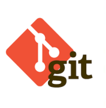

# Sistemas de control de versiones: Git

* Git es una herramienta rápida, eficiente y moderna para el control de versiones de proyectos con archivos digitales sean o no código fuente.
  
* Git permite flujos de trabajo distribuídos en los que no tiene porque existir un repositorio central.
  
* Linus Torvalds creó Git de acuerdo a las necesidades del kernel pero ofreció una gran herramienta a la comunidad en general.
