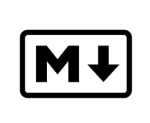

# Lenguajes de marcas: MarkDown

  

Markdown es un lenguaje de marcado que facilita la
aplicación de formato a un texto empleando una serie de
caracteres de una forma especial.

Fue creada en 2004 por John Gruber.

Markdown nació como herramienta de conversión de
texto plano a HTML.

Markdown también se considera un lenguaje que tiene la
finalidad de permitir crear contenido de una manera
sencilla de escribir, y que en todo momento mantenga un
diseño legible, así que para simplificar puedes
considerar Markdown como un método de escritura.

